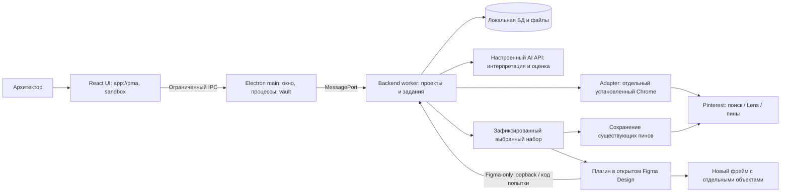

# Карта системы

Статус: локальный веб-прототип реализован; ниже согласованная desktop-цель 2026-11-06, ещё без оболочки/установщика/API-режима. [ADR 0011](../06-решения/журнал-решений/2026-11-06-десктопное-приложение.md), [подробные границы](../05-стек/десктопное-приложение.md).

Pinterest формирует кандидатов; AI помогает интерпретировать замысел и необязательно оценивает соответствие. В коде реализован DOM-адаптер Playwright/Chrome; постоянные условия и переносимость остаются предметом [экспериментов](../06-решения/проверка-интеграций.md). Сейчас AI вызывает Codex CLI; настраиваемый API — согласованный минимум будущего desktop-релиза.

Один логический backend обслуживает проекты и сохраняемые задания; отдельный брокер/микросервисы не нужны. Desktop разделяет main, renderer и utility worker ради жизненного цикла и доверия. Проектные данные и непрерывный AI-учёт размещаются вне установки. Плагин — необходимый клиент Figma, не серверный микросервис; его HTTP bridge не открывает обычный UI API.

UX — визуальный рабочий интерфейс с конечной сеткой, прогрессом и понятным частичным результатом. Звуки, бесконечная лента и ночной автопоиск не нужны.

См. [ядро и права](../02-ядро/права-доступа.md), [данные](../03-данные/сущности.md), [потоки](../04-потоки/сценарий-и-состояния.md), [границы](границы.md).
