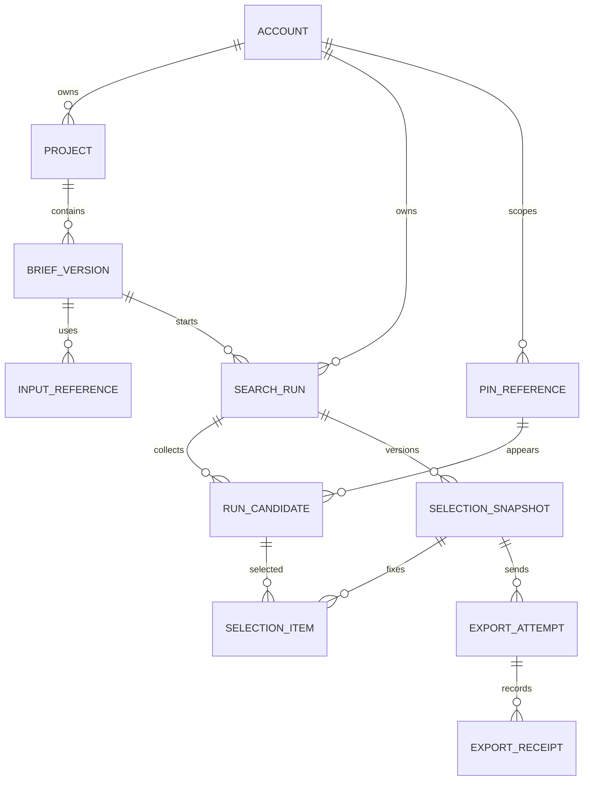

# Связи данных

Статус: логическая схема, не миграция. Каждая линия показывает кардинальность; RunCandidate и SelectionItem раскрывают связи N:M.

Проект имеет 0..1 проектную secret board; неподключённая доска не означает, что можно сохранить в глобальную доску по умолчанию. Подборка имеет 0..N попыток экспорта; новый снимок — новая версия, повтор той же попытки — восстановление.

См. [сущности](сущности.md), [инварианты](правила-нерушимые.md), [экспорт](../04-потоки/сценарий-и-состояния.md).
