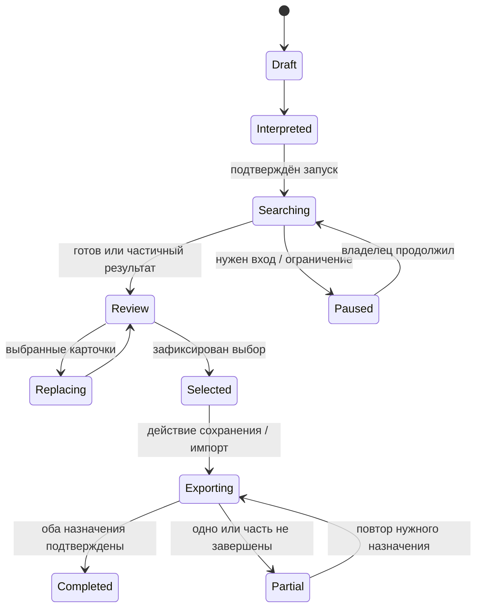

# Сценарий и состояния

Статус: предлагаемая модель реализации.

2026-11-05, [ADR 0010](../06-решения/журнал-решений/2026-11-05-восстановление-pinterest-входа.md): отсутствие/несовпадение Pinterest username теперь также переводит run в `blocked/login`, даже если logout-страница не содержит прежнего login-modal селектора. Owner/checkpoints/выбор сохраняются, продолжение явное. Проверка username до/после каждой порции DOM-сбора предотвращает checkpoint карточек сменившегося аккаунта.

Дополнение 2026-11-05: необязательный AI-отбор добавляет `ranking`. [Замена](../06-решения/журнал-решений/2026-11-05-точечные-замены.md) создаёт дочерний run с исходными карточками/выбором: `queued → searching → downloading → ranking? → ready`, после чего отдельное состояние замены `review → applied/discarded`. Пока нет решения, экспорт этой версии заблокирован. Worker обновляет варианты, применение проверяет revision и сопоставление ID. При сбое/отмене исходный набор сохраняется; загруженные варианты можно просмотреть вручную. Неподтверждённый inference после перезапуска становится unknown, повтор не выполняется автоматически.

Реализованная часть на 2026-11-03: `queued → searching → downloading → ready`; `blocked` при видимой проверке/входе; `interrupted` после перезапуска активного задания, а с 2026-11-09 также после блокировки PMA, смены аккаунта, истечения сессии и штатной остановки ([ADR 0012](../06-решения/журнал-решений/2026-11-09-остановка-владельцем.md)); явная «Отменить» остаётся `cancelled`. По ходу сбора сохраняются нормализованные ссылки, по ходу загрузки — файлы; выбор не сбрасывается при продолжении. `blocked/interrupted → queued` только через кнопку «Продолжить поиск» в исходном аккаунте. «Открыть Pinterest» показывает существующую страницу, чтобы пользователь мог завершить проверку вручную. Фоновый CAPTCHA-badge не является паузой. Целевой полный поток ниже ещё не реализован. См. [ADR 0003](../06-решения/журнал-решений/2026-11-03-локальный-прототип.md).

Cancel/Failed возможны у активных шагов. Сервис сохраняет этап и владельца до внешнего действия; после сбоя не начинает поиск заново автоматически.

## Два назначения

Реализовано 2026-11-05: неизменяемый `selection` и общий export, отдельные `pinterest-export`/`pin-save` и `figma-attempt`. Pinterest: `prepared → running → succeeded/partial/unknown/conflict/failed`; Figma: `prepared → importing → imported/unknown/conflict`. Перезапуск помечает незавершённую запись как unknown, автоматического продолжения мутаций нет. UI показывает результаты независимо; код Figma можно обновить для прежнего снимка, даже если текущий выбор уже другой. Явная новая Figma-попытка ограничена тремя на снимок. Детали и результаты — [ADR 0007](../06-решения/журнал-решений/2026-11-05-независимые-экспорты.md).

Фиксируется неизменный snapshot. Для Pinterest и Figma создаются отдельные попытки и статусы: pending/running/succeeded/partial/failed/unknown. Сохранение в Pinterest может завершиться до запуска плагина Figma; UI показывает оба результата.

Удалённой транзакции между Pinterest и Figma нет. Автоматического rollback удалением уже сохранённых пинов/фреймов не планируется. Повторяется только незавершённый target. При timeout-after-success сначала сверяется фактическое состояние.

Новый запрос создаёт новый run и новый фрейм при экспорте. Retry того же экспорта восстанавливает текущую попытку. Ручная правка старого фрейма не является командой синхронизировать Pinterest.

## Переключение аккаунтов

account_id задачи неизменен. Задачи A не получают токен B, а callback A не появляется в проектах B. Если прежнее подключение недоступно, шаг приостанавливается до входа владельца.

См. [инварианты](../03-данные/правила-нерушимые.md), [модель](../03-данные/сущности.md), [способности](../02-ядро/способности/README.md), [триггеры](триггеры.md).

## Исходный и сохранённый Pinterest ID

Save может создать пользовательский экземпляр с новым ID. Квитанция хранит source→saved и board/owner; поиск дублей и сверка не требуют равенства двух IDs. Исходная ссылка Figma остаётся исходной. См. [ADR 0002](../06-решения/журнал-решений/2026-11-02-pin-id-после-сохранения.md).
