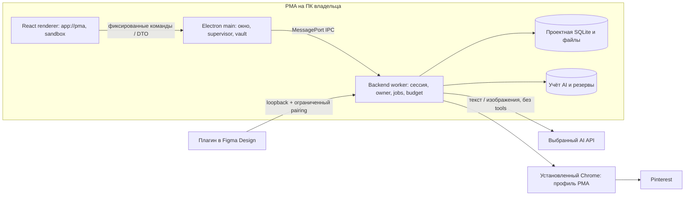

# Десктопное PMA: компоненты и эксплуатационный контракт

Обновлено: 2026-11-06. **Согласовано как целевая архитектура, не реализовано.** Основание — [ADR 0011](../06-решения/журнал-решений/2026-11-06-десктопное-приложение.md). Архитектурная сессия не разрешает автоматически начинать реализацию.

## Статусы и исходная реализация

**Реализовано** — код и зафиксированное доказательство. **Согласовано** — принятое целевое решение, код может отсутствовать. **Предложено** — уточнение механизма внутри решения. **Требует проверки** — результат ещё не получен. Старые ADR сохраняют даты и пределы своих испытаний.

| Граница | Сегодня | Desktop-цель |
|---|---|---|
| Запуск | npm/start, Node 24+, браузерный UI | Установщик, ярлык, Electron; пользователь не запускает сервер или npm |
| Backend | createPmaServer + Store/Pinterest/jobs | Отдельный utilityProcess, общий dispatcher и desktop IPC |
| Данные | workspace/.local/pma, одна SQLite + файлы | Стабильный LocalAppData, версии схемы, отдельная непрерывность AI-учёта |
| Pinterest | Установленный Chrome, отдельные persistent-профили | Тот же подход с диагностикой и supervisor |
| AI | Codex CLI/ChatGPT; путь APPDATA/npm и process.execPath | Для пилота API-профиль владельца, без обязательного CLI/подписки |
| Figma | Development-плагин, localhost:8787, пакет v2 | Готовая поставка, стабильный путь, проверка app/plugin protocol |

Источники кода: [запуск](../../../server/index.mjs), [HTTP](../../../server/app.mjs), [Store](../../../server/store.mjs), [Pinterest](../../../server/pinterest.mjs), [AI](../../../server/codex-selection.mjs), [UI API](../../../src/api.ts), [сборщик плагина](../../../scripts/build-plugin.mjs). 141 тест/build — последний ранее зафиксированный результат; desktop-проверки ещё не выполнялись.

## Процессы и границы доверия



- Renderer считается менее доверенным: sandbox=true, contextIsolation=true, nodeIntegration=false. Только упакованные UI-ресурсы, CSP, запрет произвольной навигации/окон/разрешений. Pinterest не встраивается в привилегированное окно.
- Main управляет жизненным циклом, известными системными диалогами и сервисом секретов. Нет универсальных execute/readFile/openUrl IPC или передачи ipcRenderer целиком. Открытие внешнего источника — отдельная проверенная HTTPS-операция.
- Worker единолично открывает данные и исполняет доменные операции. UI не назначает доверенный owner/session через DTO. Модель и содержимое Pinterest не могут выдавать команды IPC, менять подключение или экспорт.
- Отдельный Chrome содержит Pinterest-вход своего подключения. Cookies и пароль Pinterest не читаются приложением для передачи модели, в отчёт или плагин.
- Figma-плагин имеет доступ только к одной экспортной попытке. API-ключ, общий список проектов и файловый корень ему не выдаются.

## Транспорт UI, авторизация и медиа

Из app.mjs выделяется общий dispatcher бизнес-операций; dev HTTP и desktop IPC используют одинаковые проверки. Это рефакторинг транспорта, не переписывание поиска, замен, экспортов или Store.

Preload предоставляет небольшой версионированный API известных команд: bootstrap/unlock/lock, проекты/briefs/runs/selection/replacements/exports, настройки AI и диагностические действия. Для каждой команды фиксированы схема, размер, допустимое состояние и право. Main проверяет доверенные webContents, top-level frame, origin и известный request ID. MessagePort принадлежит только текущему worker.

Пароль PMA, один активный владелец, 30 минут, ограничение неверных попыток и старт заблокированным сохраняются. В desktop сессию создаёт и проверяет worker по контексту доверенного клиента; HTTP-cookie прототипа не заменяется переданным из renderer полем owner. Ответ содержит request ID и поколение сессии; после lock/A→B/перезапуска старый ответ не показывается и не применяется.

Проверка сессии/owner повторяется после await перед выдачей приватных данных, записью и late callback. Инварианты проекта, run, uploads, snapshot и revision остаются в backend, а не только в transport adapter.

app://pma регистрируется как ограниченный standard/secure custom protocol. Статика берётся только из манифеста поставки; приватные media/report — по opaque ID и после авторизации worker. Произвольные пути, traversal, file URL, symlink-выход и чтение произвольного адреса запрещены. Чувствительные ответы не кэшируются; при lock очищаются экран, приватные object URLs и окна отчётов. Отчёт не получает привилегированный preload.

## Loopback Figma и порт

В desktop слушать только 127.0.0.1:8787; плагин использует разрешённый http://localhost:8787. Порт сохраняется ради проверенного подключения. Никакой сети LAN, поиска свободного неизвестного сервиса или автоматического подключения к listener на этом порту.

Desktop listener содержит только /api/figma/package, claim, checkpoint, receipt и необходимые OPTIONS. Обычные API/bootstrap/account/media/report/G1 маршруты закрыты. Host проверяется на точный localhost/127.0.0.1 и порт; Origin допускается только согласно проверенному контракту плагина (нынешний UI — null/без Origin). Origin и CORS не удостоверяют личность: каждый запрос требует действующего ограниченного pairing.

Pairing связан с owner, открытой сессией, snapshot, attempt и 15 минутами; в хранилище нет сырого кода. Сохраняются lease 120 секунд, checkpoint до содержимого фрейма, полный receipt, повторная авторизация после чтения тела и сверка unknown до записи. Перевход обновляет код того же набора, не создаёт новый фрейм.

Main получает подтверждение собственного bind по IPC до показа pairing. Если порт занят, обычная работа через IPC может быть доступна, Figma помечается недоступной; чужой процесс не трогать. При смерти worker pairing отзывается, bridge считается остановленным. Защита от вредоносных программ той же Windows-учётной записи не обещается; CORS и loopback не подменяют эту границу.

## Runtime и ОС

| Компонент | Поставка / обнаружение | Gate |
|---|---|---|
| Electron / Node | Поддерживаемая стабильная ветка с Node 24.x; runtime включён | ESM, node:sqlite, файловые операции и worker проходят в установленном пакете |
| Playwright | Версия пакета и необходимые runtime-ресурсы включены явно | Запуск/управление Chrome из utilityProcess, пути с пробелами/кириллицей |
| Chrome | Уже установлен; проверка версии/расположения без чтения чужого профиля | Отдельный PMA-профиль и ручной вход; политика браузера/прокси не блокируют управление |
| Figma Desktop | Внешний установленный клиент и доступ к Design-файлу | Разрешён импорт локального плагина и loopback в нужном аккаунте |
| AI API | HTTPS endpoint/key/model владельца, доступ из рабочей сети | Возможности модели, бюджет и явная проба; нет зависимости от Codex |
| Codex CLI | Второй desktop-режим «Подписка ChatGPT (Codex)» с 2026-11-13 ([ADR 0013](../06-решения/журнал-решений/2026-11-13-ai-через-подписку-codex.md)) | Нативный `codex.exe` из официального установщика/npm/PATH, вход владельца через ChatGPT, явная проверка; без переноса developer auth |

На текущем ПК read-only .NET проверка дала Windows 10.0.19045/X64. Для архитектора Windows 10 — пока предположение. Целевая первая сборка предлагается x64 после подтверждения её ПК; 32-bit/ARM/macOS не объявляются поддержанными.

Официальная актуальная документация Playwright требует Windows 11+. Поэтому Windows 10 — отдельное проверяемое исключение, а не обещанная upstream-поддержка. Успех существующего прототипа не доказывает установленный desktop-пакет. При провале пробы остановить передачу, обсудить окружение/объём; не закреплять старый небезопасный runtime ради запуска.

Chrome и Figma документируют Windows 10 для соответствующего 64-bit/Intel окружения; это не подтверждает всю цепочку. Наличие админ-прав не отменяет корпоративные ограничения браузера, прокси, Figma и API.

Ресурсы исполняемых процессов и Playwright размещаются так, чтобы не требовать реального cwd внутри ASAR; node_modules целиком из workspace не копируются без анализа runtime-набора. process.execPath Electron нельзя считать обычным node.exe для старого CLI launcher. Все относительные пути разработки/seedG1 исключаются из production bootstrap.

## Жизненный цикл

1. Получить single-instance/data-root lock до Store, ledger, schema check, миграций и recovery. Второй запуск фокусирует окно; не создаёт второй worker/Chrome.
2. Проверить права каталога, свободное место и версии данных. Новый пакет не меняет данные до проверки совместимости. Production не выполняет seedG1.
3. Запустить один worker и дождаться подтверждённого IPC handshake/готовности. UI при сбое показывает диагностику; запуск операций заблокирован.
4. Крестик означает выход: запретить новые операции → отозвать доступ/pairing → abort jobs → сохранить checkpoints/unknown → закрыть Chrome → worker/БД → main.
5. Предлагаемый верхний срок штатного shutdown — 15 секунд. По deadline принудительно завершить только контролируемое дерево PMA; механизм Windows supervisor квалифицируется отдельной пробой. Не использовать массовое завершение chrome.exe/node.exe или один PID без подтверждения принадлежности.
6. После аварии main/worker не остаётся управляемый Chrome. Неопределённые inference/записи сохраняются консервативно. Следующий запуск заблокирован и предлагает явное продолжение или readback; автоматического восстановления внешних записей нет.

Отмена сетевого запроса не обещает отмену уже принятой провайдером обработки. Успешные исторические квитанции сохраняются. Сон, завершение Windows и потеря питания рассматриваются как аварийный путь, а не только before-quit.

## Данные, секреты и схемы

Предложенная структура стабильного %LOCALAPPDATA%/PMA:

```text
data/                 проектная SQLite, assets, uploads, экспортные пакеты, результаты AI
accounting/           авторитетный ledger вызовов/стоимости и непрерывность учёта
profiles/<connection> отдельные persistent Chrome-профили
settings/             несекретные профили подключения и настройки
secrets/              только защищённые OS-bound значения/ссылки vault
diagnostics/          безопасные журналы и явно созданные отчёты
backups/              защищённые технические pre-migration копии
integrations/figma-plugin/  готовый плагин по стабильному пути
shell/                данные Electron session/cache, отдельно от проектов
```

Точный layout уточняется при реализации с единым resolver; корень не зависит от версии установщика или cwd. Реализовано 2026-11-09 (8D.3): `server/data-root.mjs` создаёт этот layout; блокировка — `instance.lock` в режиме SQLite EXCLUSIVE (снимается ОС при смерти процесса); версия проектной БД — `PRAGMA user_version`; ledger — `accounting/ledger.sqlite`, в проекте хранится только привязка `{ledgerId, seq}`. Не использовать Roaming AppData по умолчанию для больших изображений и Chrome-профилей. Назначить Electron userData/sessionData осознанно, не смешивать их с проектными файлами.

API-профиль принадлежит неизменному connectionId владельца. Backend хранит только ссылку на секрет; main/vault отдаёт ключ worker по внутреннему каналу для разрешённого запроса. Renderer может записать/заменить/удалить ключ и видит только статус/маску, без операции чтения ключа. Перед изменением профиля проверяется актуальная сессия. DPAPI не является шифрованием всей базы/изображений и не защищает от других приложений того же OS-пользователя.

Версии app/data schema/accounting schema/plugin protocol различаются. Миграции упорядочены, повторяемы и проверяются на искусственных данных. Неизвестная новая схема открывается диагностикой, без записи и downgrade. До миграции — технический backup согласованного состояния закрытой БД/WAL и связанных immutable-файлов с SHA-манифестом. Одна копия открытого pma.sqlite не считается backup.

Техническая копия экземпляра содержит данные нескольких владельцев и доступна только доверенному локальному операторскому восстановлению в том же защищённом контуре; она не выдаётся как пользовательский экспорт. Vault-ключи, browser cookies/profiles, действующие pairing/session secrets не экспортируются. Локальные парольные хеши/метаданные в технической копии остаются конфиденциальными. Restore проверяет версию/целостность/owner, закрывает сессии и коды, сохраняет неизменные snapshots/receipts и не открывает данные старой программой.

Учёт расходов не заменяется проектным backup. Предложено отдельное accounting-хранилище: атомарные claim/reservation/debit одного operation ID находятся в одной транзакции ledger; проектная запись связывается с резервом до отправки. Сбой между резервом и проектной записью учитывается консервативно и не разрешает второй вызов. Restore объединяет сохранённые резервы без уменьшения текущего расхода. При утрате актуального ledger платный AI закрыт до подтверждённой сверки.

Резервирование/восстановление двух хранилищ — новый проверяемый контракт, не уже реализованная распределённая транзакция. Перенос проектов на другой ПК, portable owner-backup и перенос авторизации требуют отдельной согласованной процедуры. В этой сессии перенос не выполняется.

Удаление установщика/приложения сохраняет данные и backup. Хранение — до явного owner-действия, без TTL/автоочистки. Пользовательское удаление ещё не реализовано; сохраняются активные ссылки/shared assets, pending/paused/unknown, учёт расхода. Локальное удаление не удаляет внешние доски и фреймы. До новых операций проверяется место на диске; ENOSPC не лечится скрытой очисткой.

## AI-профиль и денежный бюджет

Первый desktop-релиз использовал только API; с [ADR 0013](../06-решения/журнал-решений/2026-11-13-ai-через-подписку-codex.md) владелец явно выбирает API или подписку ChatGPT через Codex, без перехода между ними. Из interpretation/ranking выделяются discovery/invoke: детерминированные prompt/schema/ID validation не зависят от исполнителя.

Настраиваемые поля: HTTPS base URL, wire format, model ID, секрет key, возможности/лимиты модели, валюта бюджета, месячный предел, тариф/единицы и дата его проверки, верхний предел вывода/стоимости запроса. Тариф вводится или подтверждается владельцем; цены и курсы не выдумываются. Профиль может адресовать любого провайдера, реализующего проверяемый контракт, без списка разрешённых брендов.

Проверяются конкретные text+image payload, строгая JSON-схема, ответ/отказ, usage, ограничения изображений/context/output и тарификация. Responses и Chat Completions оформляются разными адаптерами. Каталог моделей или слово compatible не доказывают ни доступ, ни возможности. Формат схемы адаптируется без ослабления backend validation; неизвестные ID/tool calls/неполный ответ не исполняются.

Endpoint — публичный HTTPS с проверкой назначения и запретом служебных/private/loopback адресов, URL credentials и произвольных redirects. Ключ не отправляется другому хосту. Поддержка локальных LLM, произвольных proxy/headers/других протоколов не выводится из слова «любой» и требует отдельного решения.

Сохранение настроек и startup не делают inference. Платная проверка модели — отдельное явное действие с показом расхода; она проходит через тот же бюджет и счётчик 100. Тест текста не доказывает изображения. Число/размер изображений модели проверяется до inference; ограничение провайдера не вызывает скрытые дополнительные batch-вызовы.

Вызовы интерпретации/отбора/замен/проверки используют общий локальный месячный пул до 100 (Europe/Moscow); денежный бюджет относится к владельцу за месяц и охватывает смены его API-профилей. В desktop настройках можно выключить AI или уменьшить предел; повышение выше 100 не является частью пилота. Legacy env прототипа с другим положительным конечным пределом не переписывается молча.

До отправки атомарно резервируются слот и верхняя стоимость по неизменяемому снимку provider/model/wire format/тарифа/лимитов/входа. Учитываются все billable input/image/output/reasoning единицы по доказанному billing mapping. Одного ручного числа «цена токена» недостаточно, если верхняя стоимость изображения или ответа неизвестна: такой профиль не допускается к платному вызову до проверки.

Сохранённый результат переиспользуется без inference. После подтверждённого ответа резерв сверяется с usage; неизвестный usage/отмена/timeout не возвращают остаток автоматически. SDK retries отключены; сетевой unknown не повторяется и не переключает модель/провайдера. Изменение профиля не перерасчитывает задним числом старые расходы и не обнуляет месяц.

Денежный предел — граница действий PMA по проверенному тарифу. Он не контролирует другие программы, использующие тот же ключ, и не заменяет ограничения кабинета провайдера. При несовпадении usage/тарифа или невозможности верхней оценки платные шаги блокируются. Ручной Pinterest-путь остаётся доступным.

## Figma-плагин и поставка

В релиз входят собранные manifest/code/UI без ключей, изображений и пользовательских пакетов. На первом запуске PMA показывает стабильную папку плагина и короткую инструкцию Import plugin from manifest в Figma Desktop. Автоматического появления плагина после установки PMA не обещаем.

Для внутреннего пилота сохраняется development-путь с точным localhost:8787 в devAllowedDomains. Публикация Community/private organization plugin — отдельное решение. Приложение и плагин обмениваются версией протокола до claim; несовместимая пара останавливается до мутации. Обновление сохраняет путь, требует закрыть старое окно плагина и заново запустить его.

Коды после перезапуска/смены аккаунта обновляются для прежнего снимка. Native document marker не заменяет fileKey: без доступного fileKey точная копия marker+IDs остаётся неотличимой. Старые фреймы/ручные правки не перезаписываются; unknown/readback/conflict и явная новая попытка сохраняются.

Предлагается стабильный electron-builder/NSIS с обычной установкой для текущего Windows-пользователя; приложение работает без elevation. Админ-права доступны для нужных внешних установок, но не являются режимом ежедневной работы. Сборочные инструменты нужны разработчику, не архитектору. В distribution действует allowlist: runtime, код, UI-assets, готовый плагин и лицензии. Исключаются .local, seed output, developer home/config, аккаунты, cookies, ключи, пользовательские файлы и приватные квитанции.

Обновление — вручную проверенным установщиком, после остановки приложения и backup при изменении схемы. Нет фонового загрузчика обновлений. Версия/источник/контрольная сумма и процедура критического обновления документируются. Подпись/доверенная передача определяются до распространения; подпись не обещает отсутствие SmartScreen. Антивирус/защиты ОС не отключаются как штатная инструкция.

## Диагностика и минимальный UI

Нужны состояние запуска/worker, Chrome и Figma, версия приложения/схемы/плагина, доступность AI-профиля и остаток бюджета; ручные входы и понятные паузы; сохранённые проекты/briefs; отдельные статусы двух экспортов; явные restart/reconcile действия.

Отчёт об ошибке создаётся и передаётся только действием владельца. Allowlist: версии/build/arch, код ошибки/шаг, длительности/количества, технические ID и состояние без содержимого проекта. Не включать raw prompts/provider bodies/stdout/stderr, headers, ключи, cookies, pairing, локальные полные пути, изображения и private URLs. Подробные AI-результаты остаются конфиденциальными данными проекта, а не обычным журналом. Crash dump не отправляется автоматически.

Это минимальные средства самостоятельной работы, а не поручение на полный редизайн.

## Проверка и источники

Этапы — [roadmap](../08-дорожная-карта/roadmap.md). Все новые gates открыты в [приёмке](../06-решения/приёмка-десктопа.md); [G2](../06-решения/протокол-g2-2026-11-05.md) и экспертный G3 отдельны. [Premortem](../07-нефункциональные/риски-десктопа.md) выполнен изолированно, с отдельной проверкой IPC-варианта.

Официальные источники проверены 2026-11-06:

- [Electron security](https://www.electronjs.org/docs/latest/tutorial/security), [utilityProcess](https://www.electronjs.org/docs/latest/api/utility-process), [app: single instance и пути](https://www.electronjs.org/docs/latest/api/app), [safeStorage / DPAPI](https://www.electronjs.org/docs/latest/api/safe-storage).
- [Electron 45 / Node 24.22](https://www.electronjs.org/blog/electron-45-0), [Node 24 SQLite](https://nodejs.org/download/release/latest-v24.x/docs/api/sqlite.html), [ASAR](https://www.electronjs.org/docs/latest/tutorial/asar-archives). Наличие API не заменяет проверку пакета.
- [Playwright requirements](https://playwright.dev/docs/intro#system-requirements), [Chrome channels/policies](https://playwright.dev/docs/browsers), [Chrome Windows requirements](https://support.google.com/chrome/answer/16738344?hl=en).
- [Figma Desktop requirements](https://help.figma.com/hc/en-us/articles/5601429983767-Guide-to-the-Figma-desktop-app), [импорт manifest](https://help.figma.com/hc/en-us/articles/360042786733-Create-a-classic-plugin-for-development), [networkAccess](https://developers.figma.com/docs/plugins/manifest/).
- [NSIS, стабильная документация v26](https://www.electron.build/v26/docs/nsis/), [SmartScreen](https://learn.microsoft.com/en-us/windows/apps/package-and-deploy/smartscreen-reputation). Точные версии сборочных зависимостей фиксируются при реализации, без принятия preview-документации за stable.
- [OpenAI: изображения](https://developers.openai.com/api/docs/guides/images-vision), [структурированный ответ](https://developers.openai.com/api/docs/guides/structured-outputs?api-mode=responses). Это контракт конкретного API; совместимость других провайдеров проверяется отдельно.

См. [границы](../01-обзор/границы.md), [безопасность](../07-нефункциональные/безопасность.md), [расходы](../07-нефункциональные/расходы.md).
